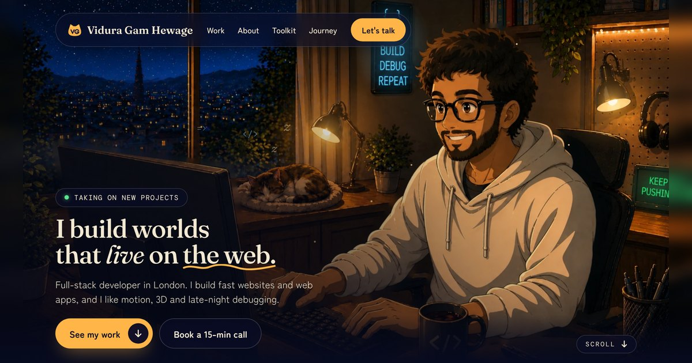

# Vidura Gam Hewage - Portfolio

[](https://github.com/ViduraV-coder/vidura-portfolio/actions/workflows/ci.yml)

My portfolio. It's one long page that starts in a painted night room, goes down through Work,
Toolkit and Journey, and ends at sunrise over the city. I'm a freelance full-stack developer in
London, and this is where clients and recruiters can see what I've built and get in touch.

Live at <https://viduvish.dev>



## What's on the page

- Hero: a painted, lamplit attic with animated lights and a "Book a 15-minute call" button. The
  underline in the heading draws itself and the green dot in the badge pulses
- About: a short intro with an animated portrait
- Work: six projects with real screenshots that scroll on hover, a list of what I delivered on
  each, a few numbers from my CV, and quotes from two people I've worked with
- Toolkit: the five areas I work in (frontend, backend, cloud and tooling, motion and 3D, CMS and
  integrations)
- Journey: study and work as a timeline that draws itself as you scroll
- Contact: book a call, copy my email, GitHub, LinkedIn and the CV

There's also a custom 404 page, `robots.txt`, `sitemap.xml`, a link preview image, structured data
(JSON-LD) and a plain fallback for when JavaScript is off. It works from 320px phones up to 4K and
5K screens, and it respects "reduce motion". On wide screens with a mouse there's also a small amber
cursor (`src/components/Cursor.jsx`). Touch screens, narrow windows and reduced motion keep the normal
one.

## Built with

- React 18 and Vite
- Tailwind CSS v4, plus a little plain CSS for keyframes and the painted scenery
- Three.js for the firefly layer (lazy loaded, only where WebGL is real)
- GSAP and ScrollTrigger for scroll reveals and the Journey road (lazy loaded)
- Cloudflare Pages for hosting, with caching and security headers from `public/_headers`

## Running it

You need Node 20.19 or newer.

```bash
npm install
npm run dev            # dev server at http://localhost:5173
npm run build          # production build into dist/
npm run preview        # serves dist/ at http://localhost:4173
npm run lint           # eslint
npm run format:check   # prettier check (npm run format fixes it)
npm run smoke          # health check of a running copy, see Deploying
```

### Settings

Both are optional, the site works with neither. Put them in a `.env` file (git ignores it) or add
them as environment variables in Cloudflare Pages (Settings, Variables and secrets). They're read at
build time, so changing one needs a redeploy.

- `VITE_BOOKING_URL`: where the "Book a 15-minute call" buttons go. It has to start with
  `https://`. The default is my Calendly page, set in `src/data/site.js`.
- `VITE_CF_ANALYTICS_TOKEN`: Cloudflare Web Analytics token. It adds Cloudflare's small cookie-free
  beacon script. Without it there's no analytics script at all.

Both values end up in the page, so they're not secrets. If a value fails the checks it's ignored
and the build prints a warning.

## Project layout

```
index.html           title, description, link preview tags, JSON-LD, no-JavaScript fallback
public/              copied as they are to the site root
  404.html             the not-found page
  robots.txt           crawler rules and the sitemap address
  sitemap.xml          the sitemap
  _headers             caching and security headers (Cloudflare Pages)
  Vidura-Gam-Hewage-CV.pdf, favicon.svg, og.jpg
scripts/smoke.mjs    post-deploy health check (files, headers, certificate)
src/
  data/                all the words and numbers, start here (site, work, results, journey, toolkit ...)
  components/          one file per section, plus cards, small ui pieces and the painted scenes (art/)
  hooks/               scroll, motion, clipboard and media-query hooks
  lib/motion.js        loads GSAP + ScrollTrigger after the first scroll or key press
  styles/              Tailwind setup, keyframes, scenery and responsive rules
  assets/              painted images (webp), project screenshots (shots/) and bundled fonts
```

## Changing things

- Text, links, email, booking page: `src/data/site.js`
- Projects: `src/data/work.js`. Each one has a `delivered` list and a `result` slot. Leave `result`
  as `null` until a client confirms a number, then put in a short line like `'Orders up 40%'`.
- Numbers under the projects: `src/data/results.js` (right now these are the figures from my CV)
- Screenshots: `src/assets/shots/<slug>.webp`, named after the project's slug in `work.js`
  (`st-anthonys`, `purehydro`, `fletching`, `imedra`, `natyadarshitha`, `willpower`). Use the whole
  home page as one tall picture, about 1440px wide. The card scrolls through it on hover.
- Testimonials: `src/data/testimonials.js`. Two colleague quotes are in. The client slot is empty
  and stays hidden until it has a quote and a name. Set `SHOW_TESTIMONIALS` to `false` to hide the
  whole section.
- CV: replace `public/Vidura-Gam-Hewage-CV.pdf` with a file of the same name
- Accent colour: one variable at the top of `src/styles/base.css`
- Domain: the addresses in `index.html`, `public/robots.txt` and `public/sitemap.xml` point at
  `https://viduvish.dev`. If the domain changes, search for it and replace every match.

## Deploying

It's a static site. On Cloudflare Pages the build command is `npm run build` and the output
directory is `dist` (add `NODE_VERSION` = `22` if the build asks for it). Pages picks up
`public/_headers` and `public/404.html` by itself, and `robots.txt` and `sitemap.xml` are in
`public/`, so they end up at the site root. Any other static host works if you upload what's inside
`dist/`, but only Cloudflare and Netlify read `_headers`.

After a deploy, check it:

```bash
npm run smoke -- https://viduvish.dev
```

That checks the home page and every file it links to, the CV, `robots.txt`, `sitemap.xml`, the 404
page, the security headers, caching and (on https) the certificate, the http to https redirect and
HSTS. It exits with code 1 if anything fails. If you run it against `npm run preview` the header
checks will fail, because only Cloudflare applies `_headers`.

To roll back, go to the Cloudflare dashboard, Workers & Pages, the project, Deployments, pick the
last good one and choose "Rollback to this deployment". Nothing gets rebuilt, so it's live in
seconds.

Also turn off Cloudflare Rocket Loader. It rewrites script tags and can clash with the security
policy.

## Test results

Measured on 16 October 2026 against the production build, served with gzip and the headers from
`public/_headers`. These are lab numbers from a cloud sandbox, so use them as a guide. Real devices
and networks will differ.

### Lighthouse 13.5.0 (median of 3 runs, first load)

|                          | Mobile (slow 4G, 4x slower CPU) | Desktop               |
| ------------------------ | ------------------------------- | --------------------- |
| Performance              | 81 (runs: 81, 81, 81)           | 97 (runs: 97, 97, 97) |
| Accessibility            | 100                             | 100                   |
| Best practices           | 100                             | 100                   |
| SEO                      | 100                             | 100                   |
| First Contentful Paint   | 2.7 s                           | 0.6 s                 |
| Largest Contentful Paint | 4.2 s                           | 1.2 s                 |
| Total Blocking Time      | 112 ms                          | 20 ms                 |
| Cumulative Layout Shift  | 0.005                           | 0.007                 |
| Speed Index              | 2.7 s                           | 0.7 s                 |

Mobile performance is the one I want to improve. The biggest paint is the hero painting and most of
the first load is images, which Lighthouse's slow-phone profile punishes. Lazy loading the images
further down the page is the next thing to try.

The first load doesn't include Three.js or GSAP. They download after the first scroll or key press,
and Three.js only on screens wider than 700px with motion allowed and real WebGL. So the numbers
above are what someone gets before any animation code arrives.

### What gets downloaded

| File                              | Size         | Gzip   | When                                                 |
| --------------------------------- | ------------ | ------ | ---------------------------------------------------- |
| `index.html` (stylesheet inlined) | 68 kB        | 14 kB  | first load                                           |
| Main script (React and the page)  | 321 kB       | 88 kB  | first load                                           |
| GSAP + ScrollTrigger              | 110 kB       | 44 kB  | after the first scroll or key press                  |
| Three.js fireflies                | 517 kB       | 128 kB | near the story section, wide screens with real WebGL |
| Fonts (seven woff2 files)         | 208 kB total |        | first load                                           |
| Images (44 webp files)            | 2.7 MB total |        | mostly with the page, screenshots lazily             |

The first load comes to about 2.0 MB on mobile and 2.2 MB on desktop (41 and 43 requests, as
Lighthouse counts them), and 1.7 MB of that is the painted images. The whole `dist/` folder is
4.2 MB.

### Accessibility

- axe-core 4.14 (WCAG 2.0, 2.1 and 2.2 A and AA rules plus best practices): 0 violations at 1440,
  834 and 390px, with reduced motion on, and with the phone menu open.
- Keyboard: every link and button can be reached in a sensible order (22 tab stops) and each one
  shows a visible focus ring.
- Reflow and zoom: no horizontal scrolling or clipped text at 320px (400% zoom), including with the
  WCAG text spacing overrides applied.
- Reduced motion: CSS and SVG animations stop, GSAP and Three.js are never downloaded, and every
  section is still visible and complete.
- Contrast: I measured text over the painted scenes pixel by pixel at widths from 320 to 1440px,
  with reduced motion on. Almost everything clears 4.5:1. The misses are small: a lantern drifting
  behind a few words of the Toolkit caption, one card tagline at 720px, and the hero line and the
  Contact label sitting at about 4:1 over a bright patch of painting between 720 and 830px.
- Headings and landmarks: one `h1`, no skipped levels, a `main`, a labelled `nav` and a `footer`.
  There are no forms on the site.
- Not tested with a screen reader or in real Safari and Firefox yet, only in Chromium.

### Security

- Headers (`public/_headers`): Content-Security-Policy (scripts only from the site itself and the
  Cloudflare beacon), Strict-Transport-Security, X-Content-Type-Options, X-Frame-Options,
  Referrer-Policy, Permissions-Policy and Cross-Origin-Opener-Policy. The free `*.pages.dev`
  addresses are marked `noindex`.
- Dependencies: `npm audit` reports 0 vulnerabilities.
- Secrets and personal data: I scanned the source and the build for keys, tokens, phone numbers and
  personal email addresses and found nothing. The two environment variables are public by design.
- Inputs: there are no forms, logins or server. The email draft behind the call button is encoded,
  booking links have to be `https://`, and links that open a new tab use `rel="noopener"`.

### Behaviour checks

44 end-to-end checks pass in Chromium with Playwright: navigation by mouse, touch and keyboard, the
mobile menu, copying the email (including when the browser blocks it), the CV download, the project
links, the booking links, the custom cursor, the 404 page, the page with JavaScript switched off, and
no console errors or failed requests. I also built it with the environment variables unset, valid and invalid.

### Analytics

Visit numbers come from Cloudflare Web Analytics (see `VITE_CF_ANALYTICS_TOKEN`). It sets no
cookies, so there's no consent banner.

## Licence

© 2026 Vidura Gam Hewage. All rights reserved. The fonts (Fraunces, Zen Maru Gothic, DM Mono) are
bundled under the SIL Open Font License, see `src/assets/fonts/`.
